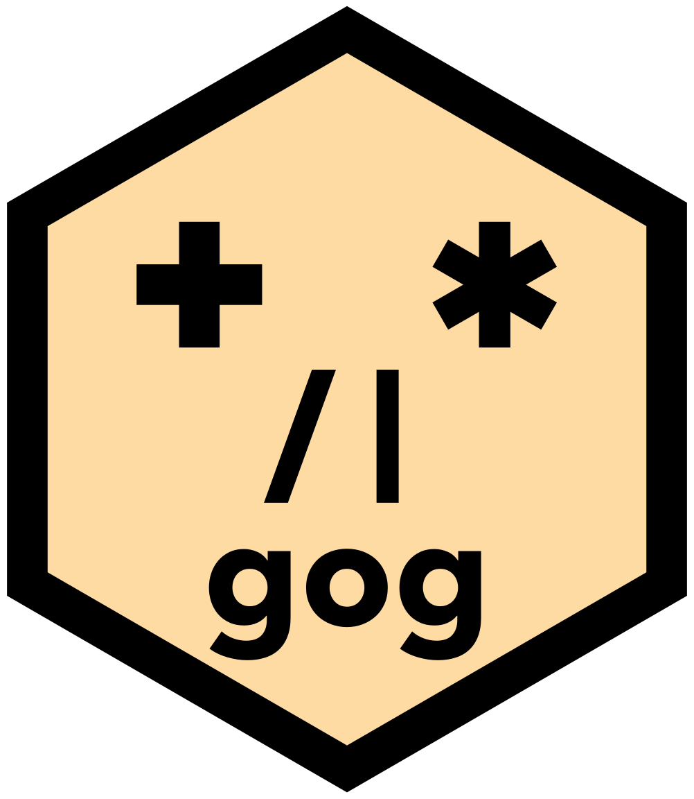
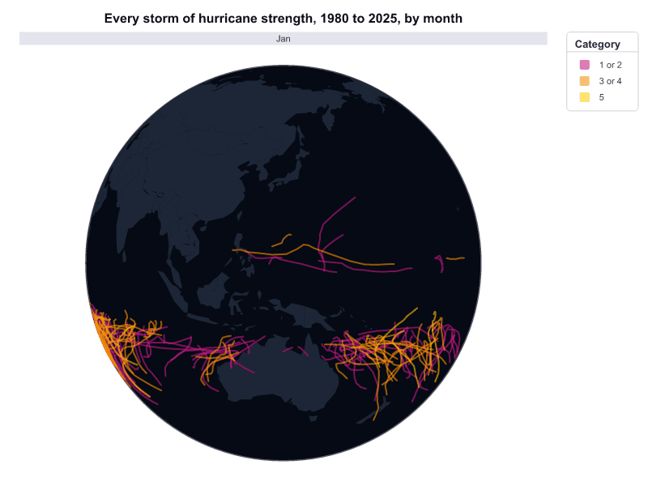
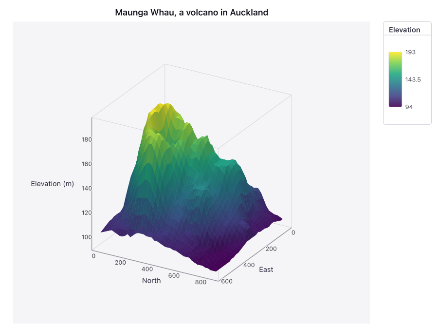
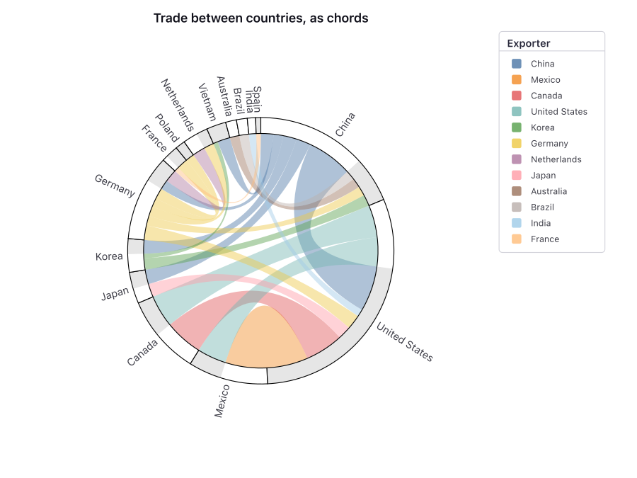
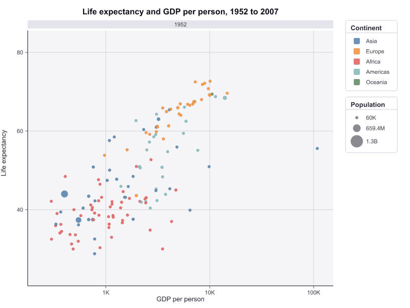
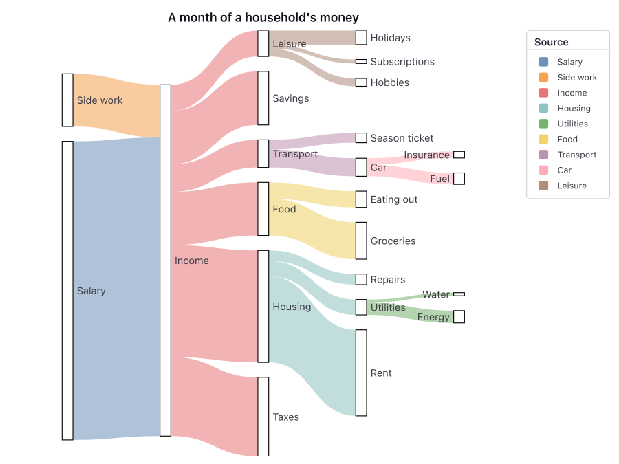
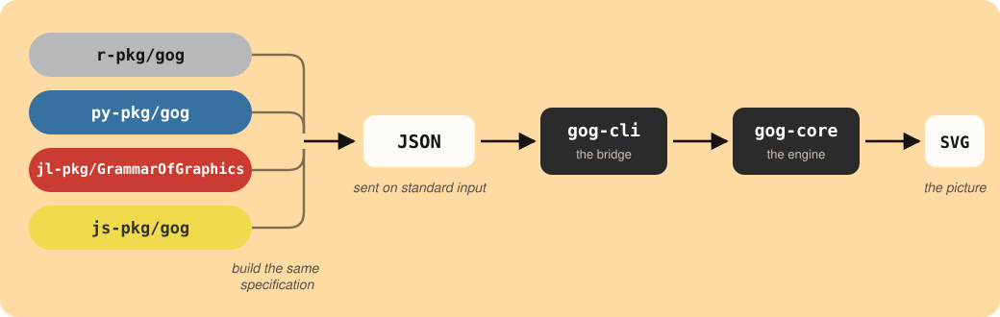

# gog — a grammar of graphics



**Be agog. Use gog.**

One graphics engine, written in Rust, that you use from four languages: R,
Python, Julia and JavaScript. Plots are **specifications, not drawing code**: you
say what you want to see, and the engine decides how to draw it.

```r
data(gapminder_2007) + point + x(gdp) + y(life) + color(continent)
```

Read it aloud: *"Given gapminder 2007: points, x is gdp, y is life, color by
continent."* That one line of code, which gog calls a sentence, is the whole
program. It names a table, a mark (`point`, one dot for each row), two positions
(`x` and `y`) and a channel (`color`). The engine chose the axes, the ticks, the
margins and the palette. It drew a legend because a column mapped to `color`
gets one, unless you turn it off with `legend = FALSE`.

**📖 The book, gog's manual, is online, and every plot in it was drawn by this
engine:
<https://psychometrician.github.io/gog-book/>**

It is also archived and citable:
[](https://doi.org/10.5281/zenodo.21807652)

## Five plots, five sentences

Each picture is drawn from the R code under it. To see the same code in Python,
Julia and JavaScript, open "Python, Julia and JavaScript" below the R code.
Each example downloads its table from the book's website with `gog_table()`. So
the code runs without changes after `library(gog)`, on a computer that is
online. Click a picture to open its page in the book, where you can turn the
3-D plots with the pointer.

<!-- showcase -->

### Storms of hurricane strength, by calendar month

<a href="https://psychometrician.github.io/gog-book/play.html#frames-on-the-globe"></a>

```r
cyclones <- gog_table("cyclones")
cyclones$month <- factor(cyclones$month, levels = month.abb)
world_borders <- gog_table("world_borders")

p <- data(world_borders) + zone + x(lon) + y(lat) + group(country) +
  style(color = "#1c2636") +
  data(cyclones) + path + x(lon) + y(lat) + group(storm) + color(category) +
  palette(c("mediumvioletred", "darkorange", "gold")) + style(opacity = 0.6) +
  play(month) + globe(turn = 135, tilt = 10) +
  theme(background = "#050a14", grid = "none") +
  title("Every storm of hurricane strength, 1980 to 2025, by month")
save_gif(p, "hurricanes.gif")
```

<details>
<summary>Python, Julia and JavaScript</summary>

```python
cyclones = gog_table("cyclones")
cyclones["month"] = ordered(cyclones["month"],
                            ["Jan", "Feb", "Mar", "Apr", "May", "Jun",
                             "Jul", "Aug", "Sep", "Oct", "Nov", "Dec"])
world_borders = gog_table("world_borders")

p = (data(world_borders) + zone + x(col.lon) + y(col.lat) + group(col.country) +
     style(color="#1c2636") +
     data(cyclones) + path + x(col.lon) + y(col.lat) + group(col.storm) +
     color(col.category) +
     palette(["mediumvioletred", "darkorange", "gold"]) + style(opacity=0.6) +
     play(col.month) + globe(turn=135, tilt=10) +
     theme(background="#050a14", grid="none") +
     title("Every storm of hurricane strength, 1980 to 2025, by month"))
save_gif(p, "hurricanes.gif")
```

```julia
cyclones = gog_table("cyclones")
cyclones["month"] = ordered(cyclones["month"],
                            ["Jan", "Feb", "Mar", "Apr", "May", "Jun",
                             "Jul", "Aug", "Sep", "Oct", "Nov", "Dec"])
world_borders = gog_table("world_borders")

p = data(world_borders) + zone + x(:lon) + y(:lat) + group(:country) +
    style(color = "#1c2636") +
    data(cyclones) + path + x(:lon) + y(:lat) + group(:storm) + color(:category) +
    palette(["mediumvioletred", "darkorange", "gold"]) + style(opacity = 0.6) +
    play(:month) + globe(turn = 135, tilt = 10) +
    theme(background = "#050a14", grid = "none") +
    title("Every storm of hurricane strength, 1980 to 2025, by month")
save_gif(p, "hurricanes.gif")
```

```js
import { plot, layer, data, gog_table, ordered, col, x, y, z, color, size,
         group, label, play, point, path, zone, ribbon, text, surface, flow,
         palette, style, theme, title, x_label, y_label, z_label, polar, globe,
         save_svg, save_gif } from "grammar-of-graphics";

const cyclones = await gog_table("cyclones");
cyclones.month = ordered(cyclones.month,
  ["Jan", "Feb", "Mar", "Apr", "May", "Jun",
   "Jul", "Aug", "Sep", "Oct", "Nov", "Dec"]);
const world_borders = await gog_table("world_borders");

const hurricanes = plot(
  data(world_borders), zone, x(col.lon), y(col.lat), group(col.country),
  style({ color: "#1c2636" }),
  data(cyclones), path, x(col.lon), y(col.lat), group(col.storm),
  color(col.category),
  palette(["mediumvioletred", "darkorange", "gold"]), style({ opacity: 0.6 }),
  play(col.month), globe({ turn: 135, tilt: 10 }),
  theme({ background: "#050a14", grid: "none" }),
  title("Every storm of hurricane strength, 1980 to 2025, by month"));
save_gif(hurricanes, "hurricanes.gif");
```

</details>

### A volcano in three dimensions

<a href="https://psychometrician.github.io/gog-book/marks/surface.html#color-by-height-per-face"></a>

```r
maunga_whau <- gog_table("maunga_whau")

p <- data(maunga_whau) + surface + x(east) + y(north) + z(elevation) +
  color(elevation) + palette("viridis") +
  z_label("Elevation (m)") + title("Maunga Whau, a volcano in Auckland")
save_svg(p, "volcano.svg")
```

<details>
<summary>Python, Julia and JavaScript</summary>

```python
maunga_whau = gog_table("maunga_whau")

p = (data(maunga_whau) + surface + x(col.east) + y(col.north) + z(col.elevation) +
     color(col.elevation) + palette("viridis") +
     z_label("Elevation (m)") + title("Maunga Whau, a volcano in Auckland"))
save_svg(p, "volcano.svg")
```

```julia
maunga_whau = gog_table("maunga_whau")

p = data(maunga_whau) + surface + x(:east) + y(:north) + z(:elevation) +
    color(:elevation) + palette("viridis") +
    z_label("Elevation (m)") + title("Maunga Whau, a volcano in Auckland")
save_svg(p, "volcano.svg")
```

```js
const maunga_whau = await gog_table("maunga_whau");

const volcano = plot(
  data(maunga_whau), surface, x(col.east), y(col.north), z(col.elevation),
  color(col.elevation), palette("viridis"),
  z_label("Elevation (m)"), title("Maunga Whau, a volcano in Auckland"));
save_svg(volcano, "volcano.svg");
```

</details>

### Trade between countries, as a chord diagram

<a href="https://psychometrician.github.io/gog-book/flow.html#the-chord-diagram"></a>

```r
trade_partners <- gog_table("trade_partners")

p <- data(trade_partners) + x(billions) +
  ribbon * flow(exporter, importer, shared = TRUE) + color(exporter) +
  zone * flow(exporter, importer, shared = TRUE) +
  text * flow(exporter, importer, shared = TRUE) + label(name) +
  polar() + title("Trade between countries, as a chord diagram")
save_svg(p, "chord.svg")
```

<details>
<summary>Python, Julia and JavaScript</summary>

```python
trade_partners = gog_table("trade_partners")

p = (data(trade_partners) + x(col.billions) +
     ribbon * flow(col.exporter, col.importer, shared=True) + color(col.exporter) +
     zone * flow(col.exporter, col.importer, shared=True) +
     text * flow(col.exporter, col.importer, shared=True) + label(col.name) +
     polar() + title("Trade between countries, as a chord diagram"))
save_svg(p, "chord.svg")
```

```julia
trade_partners = gog_table("trade_partners")

p = data(trade_partners) + x(:billions) +
    ribbon * flow(:exporter, :importer, shared = true) + color(:exporter) +
    zone * flow(:exporter, :importer, shared = true) +
    text * flow(:exporter, :importer, shared = true) + label(:name) +
    polar() + title("Trade between countries, as a chord diagram")
save_svg(p, "chord.svg")
```

```js
const trade_partners = await gog_table("trade_partners");

const chords = plot(
  data(trade_partners), x(col.billions),
  layer(ribbon, flow(col.exporter, col.importer, { shared: true })),
  color(col.exporter),
  layer(zone, flow(col.exporter, col.importer, { shared: true })),
  layer(text, flow(col.exporter, col.importer, { shared: true })),
  label(col.name), polar(),
  title("Trade between countries, as a chord diagram"));
save_svg(chords, "chord.svg");
```

</details>

### Life expectancy against GDP per person

<a href="https://psychometrician.github.io/gog-book/play.html"></a>

```r
gm_all <- gog_table("gm_all")

p <- data(gm_all) + point + x(gdp, scale = "log") + y(life) +
  color(continent) + size(population) + play(year) +
  x_label("GDP per person") + y_label("Life expectancy") +
  title("Life expectancy and GDP per person, 1952 to 2007")
save_gif(p, "gapminder.gif")
```

<details>
<summary>Python, Julia and JavaScript</summary>

```python
gm_all = gog_table("gm_all")

p = (data(gm_all) + point + x(col.gdp, scale="log") + y(col.life) +
     color(col.continent) + size(col.population) + play(col.year) +
     x_label("GDP per person") + y_label("Life expectancy") +
     title("Life expectancy and GDP per person, 1952 to 2007"))
save_gif(p, "gapminder.gif")
```

```julia
using GrammarOfGraphics: size   # `size` is also a function in Base

gm_all = gog_table("gm_all")

p = data(gm_all) + point + x(:gdp, scale = "log") + y(:life) +
    color(:continent) + size(:population) + play(:year) +
    x_label("GDP per person") + y_label("Life expectancy") +
    title("Life expectancy and GDP per person, 1952 to 2007")
save_gif(p, "gapminder.gif")
```

```js
const gm_all = await gog_table("gm_all");

const gapminder = plot(
  data(gm_all), point, x(col.gdp, { scale: "log" }), y(col.life),
  color(col.continent), size(col.population), play(col.year),
  x_label("GDP per person"), y_label("Life expectancy"),
  title("Life expectancy and GDP per person, 1952 to 2007"));
save_gif(gapminder, "gapminder.gif");
```

</details>

### A household's money, as a Sankey diagram

<a href="https://psychometrician.github.io/gog-book/flow.html#links-in-layers"></a>

```r
budget <- gog_table("budget")

p <- data(budget) + y(amount) +
  ribbon * flow(source, target, layered = TRUE) + color(source) +
  zone * flow(source, target, layered = TRUE) +
  text * flow(source, target, layered = TRUE) + label(name) +
  title("A month of a household's money")
save_svg(p, "sankey.svg")
```

<details>
<summary>Python, Julia and JavaScript</summary>

```python
budget = gog_table("budget")

p = (data(budget) + y(col.amount) +
     ribbon * flow(col.source, col.target, layered=True) + color(col.source) +
     zone * flow(col.source, col.target, layered=True) +
     text * flow(col.source, col.target, layered=True) + label(col.name) +
     title("A month of a household's money"))
save_svg(p, "sankey.svg")
```

```julia
budget = gog_table("budget")

p = data(budget) + y(:amount) +
    ribbon * flow(:source, :target, layered = true) + color(:source) +
    zone * flow(:source, :target, layered = true) +
    text * flow(:source, :target, layered = true) + label(:name) +
    title("A month of a household's money")
save_svg(p, "sankey.svg")
```

```js
const budget = await gog_table("budget");

const sankey = plot(
  data(budget), y(col.amount),
  layer(ribbon, flow(col.source, col.target, { layered: true })),
  color(col.source),
  layer(zone, flow(col.source, col.target, { layered: true })),
  layer(text, flow(col.source, col.target, { layered: true })),
  label(col.name), title("A month of a household's money"));
save_svg(sankey, "sankey.svg");
```

</details>

<!-- /showcase -->

## Why another plotting package

Most plotting tools ask you to memorize chart types. Each type is its own
picture with its own arguments in its own order, so learning one teaches you
little about the next. The best tools are real grammars instead, where small
parts combine. But their rules for combining collect exceptions over the years,
until using them well becomes a specialist's skill.

gog follows a rule taken from **Hangeul**, the Korean alphabet designed in
1443. A learner can learn it in one morning. That is not because it has few
letters: English has few letters too, and English spelling takes years to
learn. It is because **Hangeul's letters combine without exceptions**.

So a histogram is nothing to memorize. It is `bar * bin`: the `bar` mark joined
by `*` to the `bin` transform, which counts the rows in each interval. It is
built from parts, the way the Hangeul letter ㅋ (*k*) is ㄱ (*g*) with one
stroke added. Keep `bin` and change the mark, and the same counts are drawn as
a line, an area or a step. One law covers the whole package: **a rule you
learn for one mark works the same way for every mark**. If it does not, that
is a defect in gog.

Every plot has the same shape:

```
data(table) + mark + positions + refinements
```

The refinements are the optional parts, such as channels like `color()` and
labels like `title()`.

The design follows [nine laws](CONTRIBUTING.md#the-nine-laws). Two of them are
*orthogonality*, which means that a word combines with every other word it is
compatible with, and *no exceptions*, which means that a word does the same
thing in every plot. All nine refuse the same thing, *the expert's
shortcut*: a special case that saves an expert a few keystrokes and gives every
beginner one more exception to learn.

## The same plot, in four languages

<p align="center">
  
  &nbsp;&nbsp;&nbsp;
  
  &nbsp;&nbsp;&nbsp;
  <picture>
    <source media="(prefers-color-scheme: dark)" srcset="images/julia-dark.png">
    
  </picture>
  &nbsp;&nbsp;&nbsp;
  
</p>

One grammar, four spellings. In R, Python and Julia the sentence is the same,
and only the way a column is named differs. JavaScript cannot give `+ * | /` a
new meaning, so it uses six words for those four operators: `plot` for `+`,
`layer` for `*`, `across` and `down` for panels, and `beside` and `below` for
placing whole plots. (Each logo belongs to its owner, listed in
[`images/NOTICE`](images/NOTICE).)

```r
# R
data(gm) + point + x(gdp) + y(life) + color(continent)
```
```python
# Python
data(gm) + point + x(col.gdp) + y(col.life) + color(col.continent)
```
```julia
# Julia
data(gm) + point + x(:gdp) + y(:life) + color(:continent)
```
```js
// JavaScript
plot(data(gm), point, x(col.gdp), y(col.life), color(col.continent))
```

All four produce **the same SVG, byte for byte**, and a test checks it. For
Python, Julia and JavaScript, a test program draws every sentence in the book
that the language can write, and compares each file with R's.

## Install

```r
# R
install.packages("gog", repos = c("https://psychometrician.r-universe.dev",
                                  "https://cloud.r-project.org"))
```
```bash
# Python
pip install gog
```
```julia
# Julia
using Pkg; Pkg.add("GrammarOfGraphics")
```
```bash
# JavaScript
npm install grammar-of-graphics
```

All four are published, on
[r-universe](https://psychometrician.r-universe.dev/gog),
[PyPI](https://pypi.org/project/gog/),
[General](https://github.com/JuliaRegistries/General/tree/master/G/GrammarOfGraphics)
(Julia's package registry) and
[npm](https://www.npmjs.com/package/grammar-of-graphics). Python **includes the
engine in the package**, built for your platform. npm installs it as a second
package, also built for your platform. Julia's package manager downloads the
engine when it installs the package, and the R package includes it on macOS and
Windows. In all of these cases there is nothing else to install, nothing to put
on your `PATH`, and no Rust toolchain to set up.

On Linux the R package installs from source and compiles the engine. That install
needs Rust 1.75 or newer and a network connection.

Each of the four packages also includes a second build of the engine, compiled
to WebAssembly so that it runs in a web browser. On a web page it lets you turn
a 3-D plot and move a brush (a range that selects rows) by dragging with the
pointer. An R install that builds from source includes it only if it can also
compile this browser build. Without it every plot still draws, but a 3-D plot does not
turn and a brush does not move.

`gog` is not on CRAN yet, so the R command installs it from r-universe. The
second address, a CRAN mirror, is where R finds the packages `gog` needs, such
as `jsonlite`.

**What changed between versions** is recorded in two files.
[`NEWS.md`](https://github.com/psychometrician/gog/blob/main/NEWS.md) describes
the main changes in a few paragraphs, and it is what `news(package = "gog")`
prints in R.
[`CHANGELOG.md`](https://github.com/psychometrician/gog/blob/main/CHANGELOG.md)
lists every change a user could notice, including the small fixes that
`NEWS.md` leaves out.

## The vocabulary

This table lists every word of the grammar. The book calls this set of words the
kernel.
There is no `histogram()` and no other chart-type function: a chart type is a
combination of these words.

| Kind | The words |
|---|---|
| **Sources** | `data` `query` |
| **Marks** | `point` `line` `area` `bar` `step` `interval` `box` `ribbon` `text` `path` `rule` `zone` `surface` `edge` |
| **Channels** | `x` `y` `z` `color` `size` `shape` `pattern` `opacity` `group` `label` `play` |
| **Selections** | `brush` |
| **Transforms** | `bin` `smooth` `straight` `count` `density` `proportion` `sum` `mean` `median` `max` `min` `quantile` `cumulative` `range` `confidence` `deviation` `smooth_band` `straight_band` `bounds` `partition` `flow` `layout` `cluster`, plus `dodge` `stack` `jitter` `repel` |
| **Scales** | `linear` `log` `time` `category` `order` |
| **Spaces** | `flat` `space` `polar` `nest` `map` `globe` `network` |
| **Labels** | `title` `x_label` `y_label` `z_label` |
| **Settings** | `style` `theme` `palette` |
| **Composition** | `facet`, and the operators: layering `+`, derivation `*`, arranging `\|` and `/` |

Every word in the table works in the current release: every mark, every
channel, every transform and every space.

gog never accepts one of these words and then ignores it, so a plot that is
drawn shows everything you wrote.

## Architecture

<p align="center">
  <picture>
    <source media="(prefers-color-scheme: dark)" srcset="images/rust-dark.png">
    
  </picture>
</p>

All four languages send their specifications to one engine. The four spellings above are
what you write, and the engine, written in Rust, draws for all of them. Every
choice it makes, such as the ticks or the palette, comes from a rule of the
grammar, so it is the same choice in every language.

<p align="center">
  
</p>

Each binding only builds a specification, and the engine does everything else.
A rule written in one binding would need a copy in the other three, and the
copies could disagree. So a rule that two or more bindings need is written
once, in `gog-core`.

The specification says what the plot shows, never how one output format draws
it. So a second output format would change only the engine, and nothing in the
four bindings. The engine, `gog-core`, depends
on nothing but `serde` and `serde_json`. The command-line program, `gog-cli`, adds `resvg` and
`gif`, and uses them only to write a moving plot as an animated GIF.

## Build from source

Building needs Rust 1.75 or newer, and the language you will use it from.

```bash
cargo build --release
cargo test --release
cargo run --release --example scatter    # other examples: bar, transforms
```

The engine does not depend on any of the four languages. It reads a JSON
specification on stdin and writes SVG to stdout, so any program that can start
another program can use it:

```bash
echo '{ … }' | ./target/release/gog-cli > plot.svg
```

For R, install the package from this copy of the repository. `configure` puts
the engine into the package, and builds it from source if no built copy exists:

```bash
R CMD INSTALL --no-docs r-pkg/gog
```

## The book

`book/` holds the book, written in Quarto. The engine draws every plot in it
each time the book is built, so no picture in it is a screenshot. You can turn a
3-D plot and move a brush by dragging with the pointer, because the browser
build of the engine comes with the page. The book also shows the engine's
refusals. When the engine cannot draw a sentence, it says so, and the message
says what to write instead.

```bash
cd book && quarto preview
```

It opens with chapters that teach the whole grammar. The next part has a chapter
for each mark, and chapters on data, scales, channels, settings and transforms.
The part after it combines them: the operators, faceting, composition, flows,
the spaces, animation and selection. Then comes a cookbook, organized by the
shape of your data and your question, never by chart name.
After it come a part on the nine laws and why the engine refuses some
sentences, and one chapter for each language. The book shows its examples in
all four languages. The appendices hold a
one-page kernel card, the functions around the grammar, a grid of which words
combine, chart names translated into sentences, a phrasebook for ggplot2 users,
and a comparison of what gog and ggplot2 each draw.

## Contributing

To report a plot that does not draw as you expect, attach the file that
`save_json(p, "plot.json")` writes. The engine draws the same plot from that
file, whichever of the four languages wrote it. Read the file before you share
it, because it holds every value of each column the sentence names.

[`CONTRIBUTING.md`](CONTRIBUTING.md) has the nine laws the grammar obeys, the
module map, the file-organization rules, and what to run before opening a pull
request.

## License

Code is **Apache License 2.0** — see [LICENSE](LICENSE), and [NOTICE](NOTICE) for
the color schemes this project uses from other sources. The Python, JavaScript
and Julia packages keep their own copies of both. Each of these three packages
is built from its own folder in this repository, so each folder holds its own
copy. The R package includes only the `NOTICE`. R itself includes the Apache
license text, and R's package checks ask a package to refer to that text rather
than include a copy.

The book's prose is **CC BY-NC-SA 4.0** — see [book/LICENSE.md](book/LICENSE.md).
